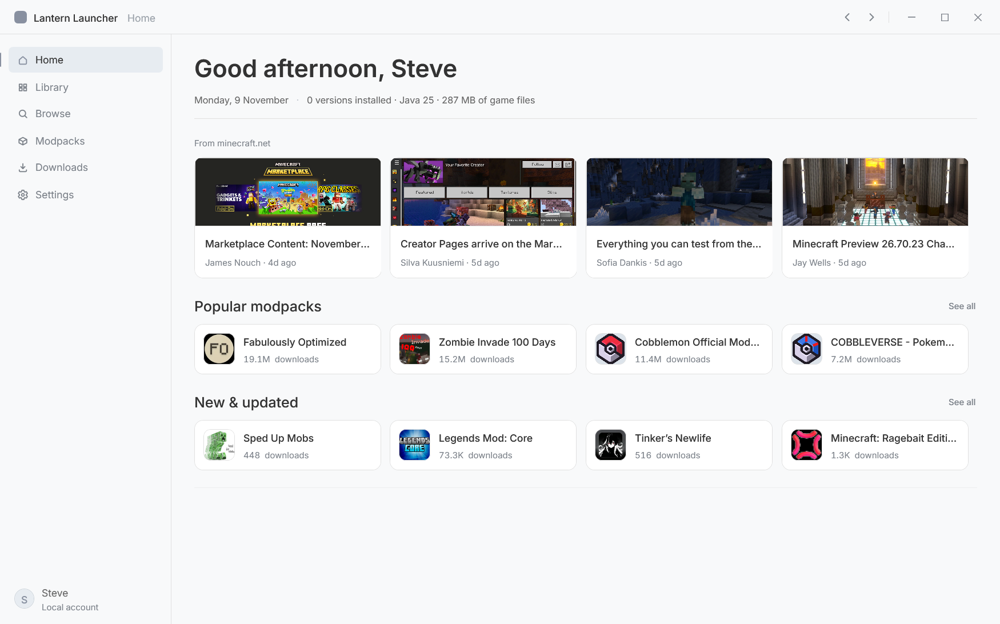
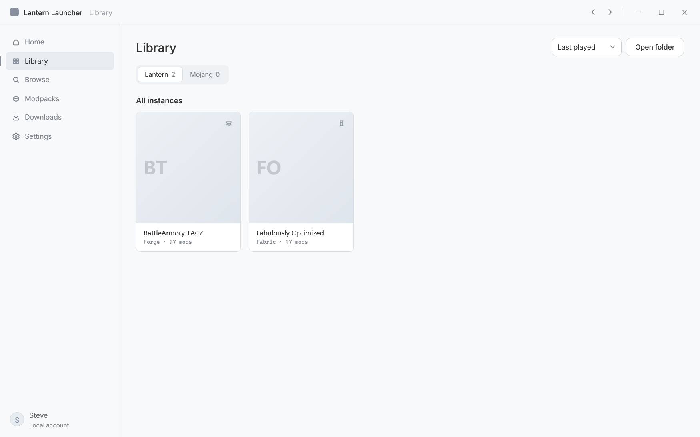
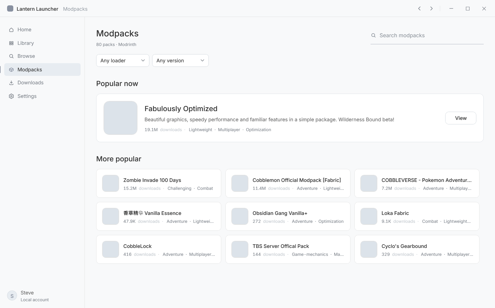

# Lantern Launcher

A Minecraft launcher for Windows, written in WPF on .NET 9.

There are no third-party UI packages here — the interface is styles, templates
and a few attached behaviours over the base class library. It also does not own
a game folder of its own: it reads the `.minecraft` versions you already have,
builds the launch command and starts the game.



## Status

In development. 0.1.0 is the first build that runs end to end: there is no
installer, no release and no account sign-in, and the pages still move between
commits. Point it at a copy of any world you care about.

## Screens

<table>
  <tr>
    <td width="50%"></td>
    <td width="50%"></td>
  </tr>
  <tr>
    <td>Library — one card per instance, each with its own mods and worlds.</td>
    <td>Downloads — progress, speed, cancel and retry, history kept on disk.</td>
  </tr>
</table>

## What works

- Scanning `versions/*` with `inheritsFrom` chains merged, so Forge and Fabric
  versions resolve against their parent.
- Java discovery from the `release` file inside each runtime. `java -version` is
  not parsed; its output is localised and goes to stderr.
- Launching: classpath, natives extraction for old versions, JVM and game
  arguments, stdout and stderr piped to a log file.
- Installing a version from the command line, with SHA1 verification and a
  BMCLAPI mirror when the official source fails.
- Two libraries, each a separate `.minecraft` root, scanned the same way.
- Instance pages with worlds, mods, shaders and resource packs counted and
  listed. Disabling a mod renames it to `.jar.disabled`.
- Downloads as a task list: live progress and speed, cancel, retry, an entry for
  any direct link, and a history that survives a restart.

## Not there yet

- No account sign-in. Only an offline profile exists.
- Browse cannot install into an instance; clicking through ends at the project page.
- No modpack import or export.
- The "other worlds" shelf on Home reads `%APPDATA%\.minecraft\saves`, not the
  instance you played last. Wrong for isolated instances.

## Build

```powershell
dotnet build "Lantern Launcher.slnx" -p:RunAnalyzers=true -warnaserror
"Lantern Launcher\bin\Debug\net9.0-windows\LanternLauncher.exe"
```

Needs the .NET 9 SDK. The build is kept at zero warnings; a new one is a bug, not
noise. CI runs the same command on every push and keeps the output as an
artifact.

## Where things live

| | |
|---|---|
| Settings | `%APPDATA%\LanternLauncher\settings.json` |
| Download history | `%APPDATA%\LanternLauncher\downloads.json` |
| Logs and crash records | same folder |
| Lantern library | `<install dir>\LanternLibrary\.minecraft`, or `%LOCALAPPDATA%\LanternLibrary\.minecraft` if the install directory is read only |
| Mojang library | `%APPDATA%\.minecraft` |

## How a launch is assembled

1. `InstanceService` scans `versions/*` and reads each version JSON.
2. `VersionService` follows `inheritsFrom`, merges the chain and filters
   libraries by platform rules.
3. `JavaService` picks a runtime that meets the version's minimum major,
   preferring the closest match.
4. `LaunchArgumentBuilder` assembles JVM arguments, classpath, main class and
   game arguments. OptiFine's tweak class is forced last, otherwise the game
   crashes when Forge is also present.
5. `LaunchService` extracts natives if the version needs them, starts the
   process and writes its output to a log.

## Instance folders

An instance is a folder under `versions/`. If it contains `mods`, `saves`,
`shaderpacks` or `resourcepacks`, that folder is used as the game directory, so
two instances do not share mods or worlds. Otherwise the library root is used.
Assets and libraries are always shared, which is why isolating an instance costs
almost no disk space.

## Interface

Light theme, one accent colour, no shadows except on floating surfaces.
Separation comes from steps of white and 1px hairlines rather than from
elevation.

| | |
|---|---|
| Canvas / surface | `#F8F9FA` / `#FFFFFF` |
| Lines | `#D9DEE4` card outline, `#E0E0E0` divider |
| Text | `#333333` primary, `#666666` secondary, `#7C828A` metadata |
| Primary button | `#59636F`, white text, 8px radius |
| Accent | `#8890A0` for selection, links and icons |

Colours come from `Themes/Tokens.xaml`. A raw hex value in a page is a bug.

Transitions run 200–260ms and only touch opacity, colour and `RenderTransform`.
Nothing animates an `Effect`: a blur re-runs every frame and drops the frame
rate. Placeholders all use the same band, defined once in
`Common/LoadingMotion.cs`; two loading animations on one screen is what makes an
interface feel noisy.

## Code map

```
Shell/      AppShell holds settings, the route stack and toasts; MainWindow animates
Services/   versions, instances, Java, downloads, launch — one job per file
Models/     the version JSON schema, resolved versions, worlds, download tasks
Pages/      one XAML page per route; view models live in PageViewModels.cs
Controls/   AsyncIcon, SkeletonTile, Toast
Common/     motion, smooth scrolling, the shared loading band, rounded clipping
Styles/     buttons, inputs, surfaces, icon geometry
Themes/     colour, type and motion tokens
```

Navigation is a stack of `Route(PageKey, arg)`. Pages get their subject from the
route argument rather than from global state.

## Debug switches

| Switch | Effect |
|---|---|
| `--shots <dir>` | Renders each page to PNG with `RenderTargetBitmap` |
| `--dump` | Report on Java, version resolution and the assembled command line |
| `--launch <id> [--smoke]` | Starts a real process and reports on log markers |
| `--install <id> [--assets]` | Installs a version without opening a window |
| `--scroll-probe` | Checks whether wheel scrolling is eased |

Environment variables, all off by default: `LANTERN_ICON_SLOW` (freeze image
slots in the loading state), `LANTERN_ICON_OFFLINE` (force image loading to
fail), `LANTERN_ICON_TRACE`, `LANTERN_ANIM_TRACE` (page transition frames),
`LANTERN_LIB_TRACE` (library switch frames), `LANTERN_SCROLL_TRACE`,
`LANTERN_NAV_TRACE`, `LANTERN_MENU_TRACE`, `LANTERN_SHOT_DELAY_MS`.

## Not in scope

Skin sites, online lobbies, friend lists, cloud sync, community features,
mobile. No telemetry, and the launcher does not update itself.
